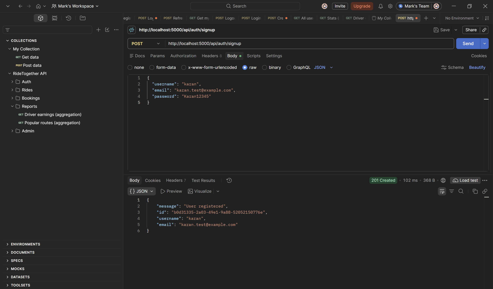
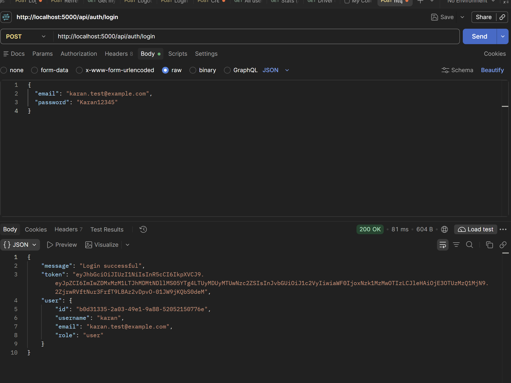
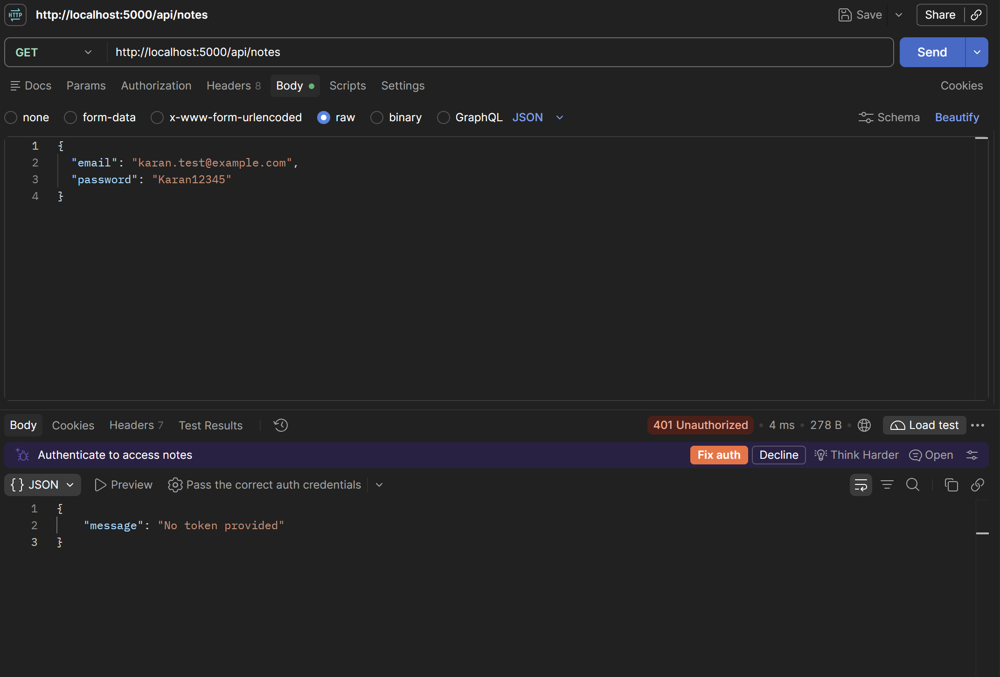
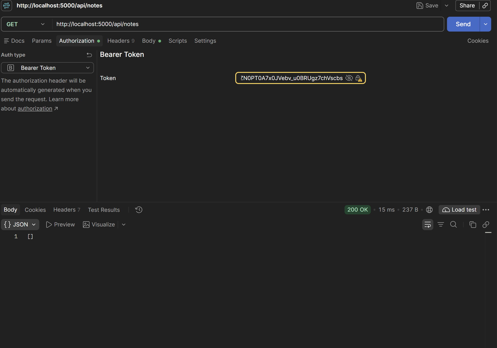
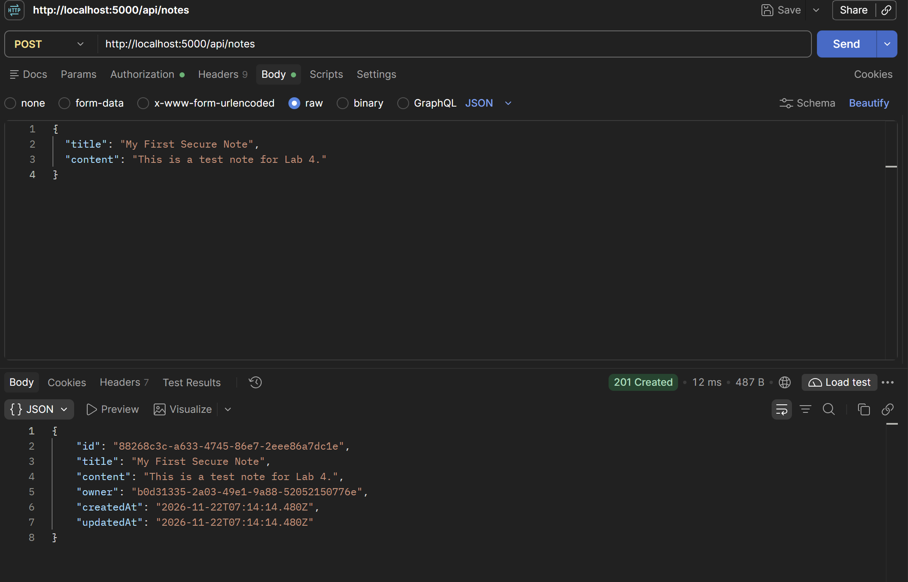
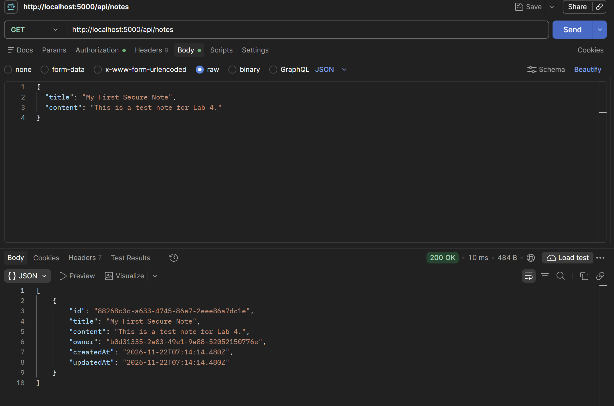
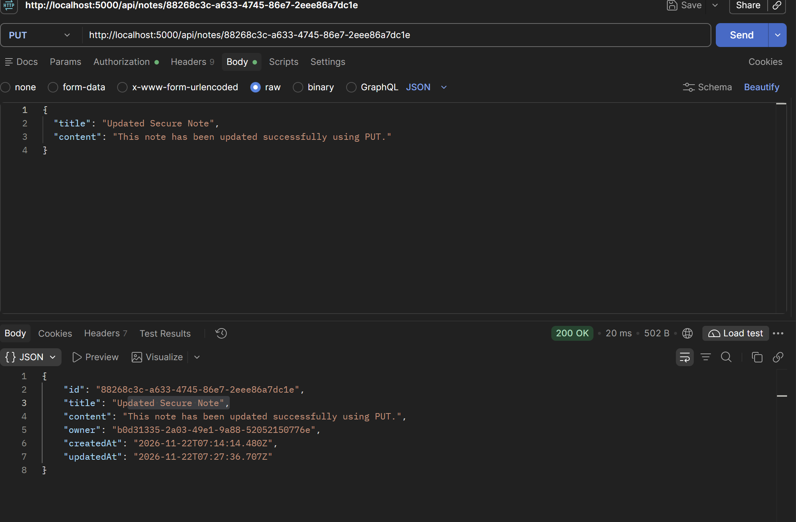
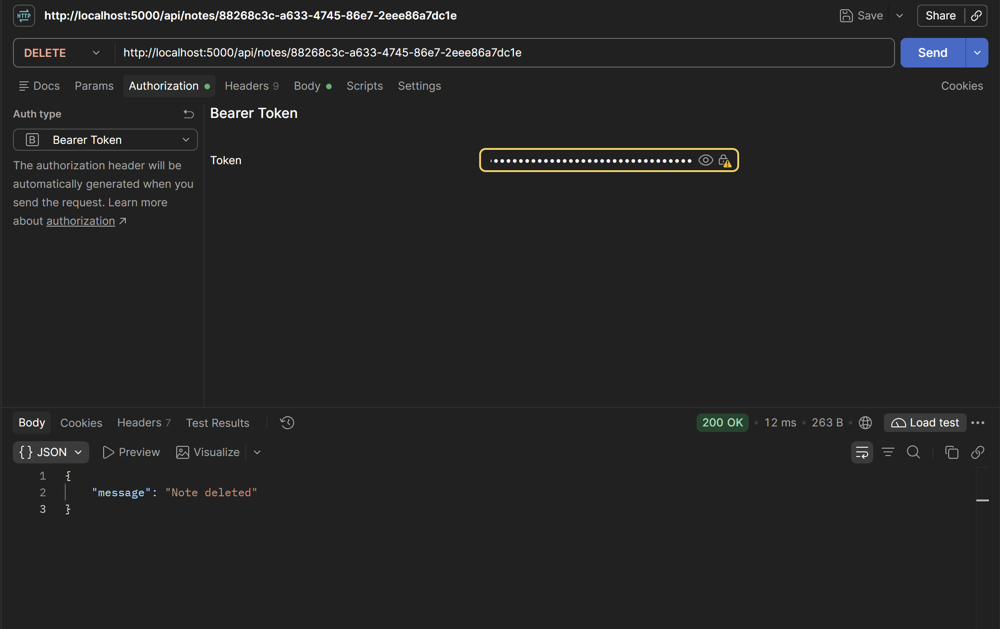
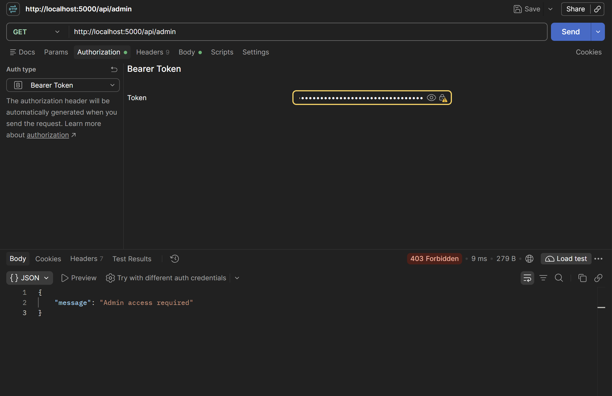
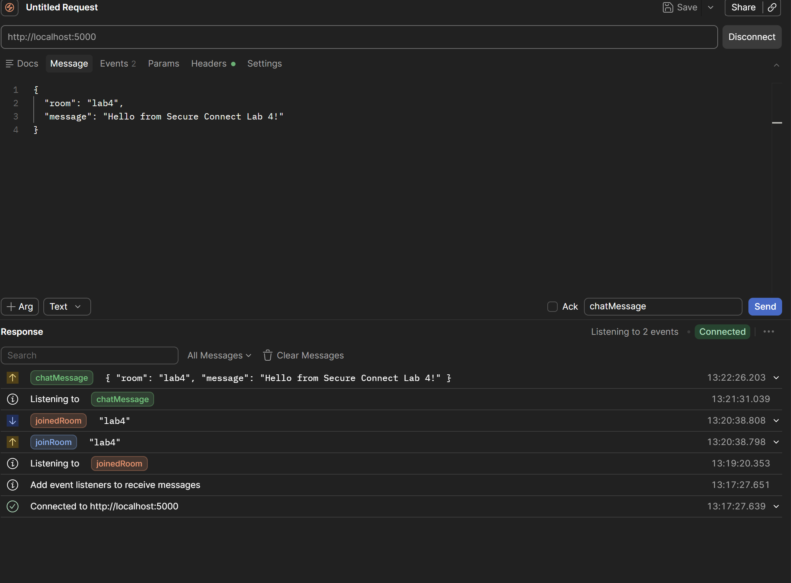

# Lab 4 – Secure Connect and Communication Platform

## Requirements
Node.js installed. This lab uses Express, bcrypt, JWT, dotenv, Socket.IO and Node's built-in file storage/EventEmitter.

## Setup
1. Open this folder in VS Code.
2. In terminal run: `npm install`
3. Copy `.env.example` to `.env` and set a long JWT secret.
4. Run: `npm start` (or `npm run dev` after installing nodemon).
5. Server: `http://localhost:5000`

## Postman API tests
All requests use `http://localhost:5000`.

## Postman Testing Screenshots

### 1. Signup


### 2. Login


### 3. Unauthorized Access


### 4. Get Notes


### 5. Create Note


### 6. Retrieve Notes


### 7. Update Note


### 8. Delete Note


### 9. Admin Access Restriction


### 10. Real-Time Chat


### 1. Signup
POST `/api/auth/signup` JSON:
```json
{"username":"victor","email":"victor@example.com","password":"123456"}
```

### 2. Login
POST `/api/auth/login` JSON:
```json
{"email":"victor@example.com","password":"123456"}
```
Copy the returned token.

### 3. Protected profile
GET `/api/profile`, header `Authorization: Bearer YOUR_TOKEN`.

### 4. Notes
For all notes requests use header `Authorization: Bearer YOUR_TOKEN`.
- GET `/api/notes` – list your notes
- POST `/api/notes` JSON `{"title":"My First Note","content":"This is my note"}`
- PUT `/api/notes/NOTE_ID` JSON `{"title":"Updated title"}`
- DELETE `/api/notes/NOTE_ID`

Notes belong to their creator. Without a token, the Notes API returns 401.

### 5. RBAC
GET `/api/admin` requires a token for an account whose role is `admin`. New signup accounts default to `user`. For a lab demonstration, change one account's role to `admin` in `store.json` while server is stopped, then restart.

### 6. Socket.IO chat
Socket.IO client connects to `http://localhost:5000` and supplies the login token in its auth object:
```js
const socket = io('http://localhost:5000', { auth: { token: 'YOUR_TOKEN' } });
socket.emit('joinRoom', 'general');
socket.emit('chatMessage', { room: 'general', message: 'Hello everyone' });
socket.on('chatMessage', data => console.log(data));
```
You may test with a separate client script after installing the Socket.IO client library (client library is not included in server dependencies).

## Notes
- Passwords are bcrypt-hashed, never stored in plain text.
- JWT is verified for protected HTTP and Socket.IO access.
- JSON file storage is used for simple persistence to avoid requiring a database setup. For concurrent or production use, replace with a database.
- EventEmitter logs chat messages to the server console.
